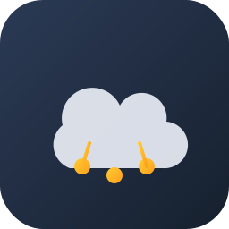

# Tuya Raw DP per Home Assistant

Repository: `andreadodo/ha_tuya_raw_dp`

Integrazione custom che legge **tutti i data point (DP) grezzi** di un
dispositivo Tuya tramite le API cloud di [Tuya IoT Platform](https://iot.tuya.com),
e li espone come sensori in Home Assistant — anche quelli che
l'integrazione Tuya ufficiale di HA non mappa su nessuna entità
standard.

Pensata per il caso in cui:
- il dispositivo (es. un device Zigbee dietro un gateway Tuya) non è
  raggiungibile in LAN, quindi `localtuya` non è utilizzabile;
- l'integrazione Tuya nativa di HA non mostra tutti i valori che il
  dispositivo espone.

Funziona **esclusivamente via cloud** (polling periodico), quindi non
richiede accesso di rete al gateway/dispositivo.

## Requisiti

- Un account su [iot.tuya.com](https://iot.tuya.com) con un Cloud
  Project creato, le API **IoT Core** e **Authorization** abilitate, e
  il tuo account Smart Life/Tuya collegato al progetto (vedi sezione
  sotto).
- Access ID / Client ID e Access Secret / Client Secret del progetto.
- Il Device ID del dispositivo (visibile in Devices → All Devices nel
  Tuya IoT Platform).

## Installazione via HACS

1. In HACS → menu (⋮) in alto a destra → **Repository personalizzati**
2. Aggiungi l'URL di questo repository, categoria **Integrazione**
3. Cerca "Tuya Raw DP" tra le integrazioni e installala
4. Riavvia Home Assistant
5. Impostazioni → Dispositivi e servizi → Aggiungi integrazione →
   cerca "Tuya Raw DP"
6. Compila il form con Client ID, Client Secret, Device ID, Data
   Center e intervallo di polling

## Configurazione del Cloud Project (una tantum)

1. Crea il progetto su iot.tuya.com (Cloud → Create Cloud Project)
2. Abilita le API **IoT Core** e **Authorization** nel progetto
3. Tab **Devices** → **Link Tuya App Account** → scansiona il QR code
   dall'app Smart Life/Tuya per collegare il tuo account
4. I tuoi dispositivi compaiono in "All Devices": da lì prendi il
   Device ID

## Riconfigurare dopo l'installazione

Non serve rimuovere e ricreare l'integrazione per cambiare Device ID,
credenziali o intervallo di polling: Impostazioni → Dispositivi e
servizi → Tuya Raw DP → **Configura**. L'integrazione si ricarica
automaticamente con i nuovi valori.

## Logo

`logo.svg` / `logo.png` / `icon.png` alla radice del repo sono usati
da HACS per mostrare l'icona dell'integrazione nello store. Per farla
comparire anche nella lista "Dispositivi e servizi" di Home Assistant
servirebbe una Pull Request al repository ufficiale
[home-assistant/brands](https://github.com/home-assistant/brands) —
passaggio manuale e soggetto a revisione, non automatizzabile da qui.

## Cosa crea l'integrazione

Un'entità sensore per ogni codice DP presente nella risposta di
`GET /v1.0/iot-03/devices/{device_id}/status`. Se il dispositivo
espone nuovi DP in un secondo momento (es. dopo un aggiornamento
firmware), l'integrazione li rileva e aggiunge automaticamente le
entità corrispondenti al giro di polling successivo.

## Limiti noti

- Dipende dalla disponibilità delle API cloud Tuya: se Tuya ha
  problemi lato server, il polling fallisce temporaneamente (gestito
  come `UpdateFailed`, le entità risultano "non disponibili").
- I value type restituiti dall'API (stringhe, booleani, numeri,
  enum) non vengono convertiti/tipizzati: il sensore mostra il valore
  così come arriva da Tuya.
- Non supporta la scrittura di DP (solo lettura), né i comandi; è un
  bridge di sola lettura per completare la visibilità dei dati.
